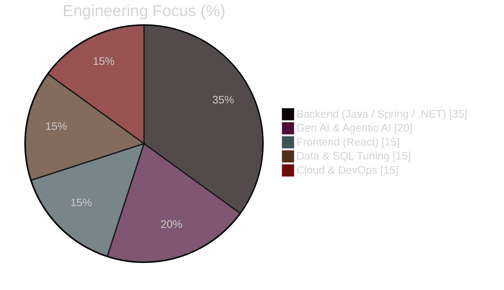
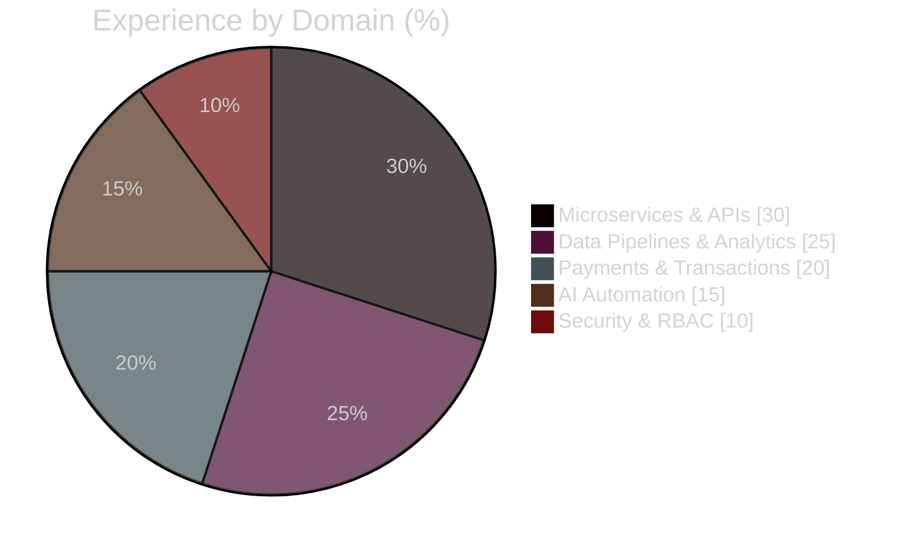
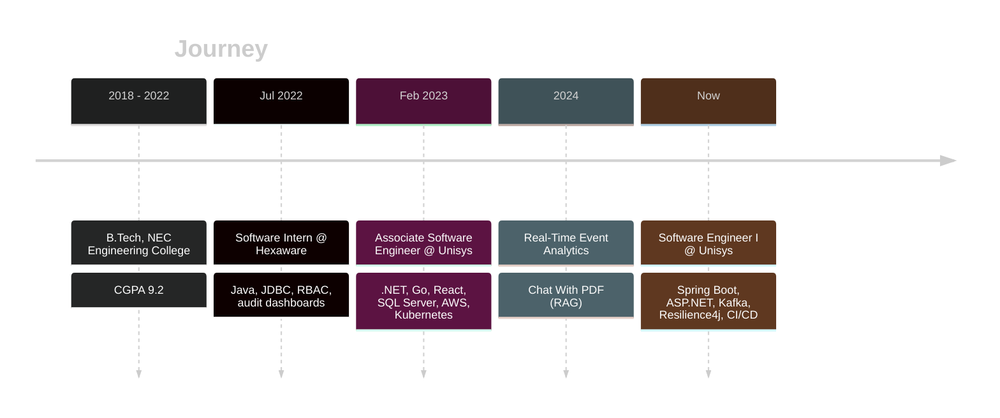

<!-- ========================= HEADER ========================= -->
<p align="center">
  
</p>

<p align="center">
  <a href="https://github.com/RamSubhash07">
    
  </a>
</p>

<p align="center">
  <a href="https://www.linkedin.com/in/ramsubhashp/"></a>
  <a href="https://leetcode.com/u/RamSubhash45/"></a>
  <a href="mailto:ramsubhashpull@gmail.com"></a>
  
</p>

---

## 👨‍💻 About Me

```yaml
name:      Ram Subhash Pullamsetty
role:      Software Engineer I @ Unisys Global Services  (Feb 2023 – Present)
previous:  Software Intern @ Hexaware Technologies       (Jul 2022 – Jan 2023)
education: B.Tech, NEC Engineering College — CGPA 9.2
focus:     [Java Spring Boot microservices, ASP.NET, React.js, Kafka, AWS, Gen AI / Agentic AI]
currently: Building production-grade RAG & multi-agent systems with LangGraph
```

- 🏦 I build **enterprise microservices** with Spring Boot and ASP.NET, made resilient with OpenFeign, Resilience4j and circuit breakers
- ⚡ I've cut **latency by 25–30%** through SQL Server tuning and data-flow restructuring, and **deployment effort by 60%** with GitHub Actions CI/CD
- 🔄 I work with **event streaming** (Kafka), **Go concurrency** and **cloud data platforms** on AWS (S3, Redshift, RDS)
- 🤖 I design **Gen AI solutions** with LLMs, RAG, LangChain and Agentic AI workflows
- 📫 Reach me at **ramsubhashpull@gmail.com**

---

## 🛠️ Tech Stack

<p align="center"><b>Languages</b><br/>
  
</p>
<p align="center"><b>Backend & Frameworks</b><br/>
  
</p>
<p align="center"><b>Data & Messaging</b><br/>
  
</p>
<p align="center"><b>Cloud & DevOps</b><br/>
  
</p>
<p align="center"><b>Gen AI</b><br/>
  
  
  
  
  
  
  
</p>

---

## 📊 Skill Distribution

<table>
<tr>
<td width="50%">



</td>
<td width="50%">



</td>
</tr>
</table>

<p align="center">
  
  
</p>
<p align="center">
  
</p>

---

## 🚀 Featured Projects

<p align="center">
  <a href="https://github.com/RamSubhash07/nexabank-microservices">
    
  </a>
  <a href="https://github.com/RamSubhash07/genai-agentic-rag-assistant">
    
  </a>
</p>

| Project | What it is | Stack |
|---|---|---|
| 🏦 **[NexaBank](https://github.com/RamSubhash07/nexabank-microservices)** | AI-powered digital banking platform: JWT auth, accounts, transfer saga with outbox, Kafka notifications, a **Spring AI assistant** (RAG + tool calling) and **real-time fraud detection** |       |
| 🤖 **[Agentic RAG Assistant](https://github.com/RamSubhash07/genai-agentic-rag-assistant)** | Enterprise RAG platform: hybrid search + reranking, a **LangGraph** corrective RAG graph, a multi-agent supervisor with human-in-the-loop, an **MCP server**, semantic cache, guardrails and evals |      |

<details>
<summary><b>📁 Earlier work</b></summary>

- **Real-Time Event Analytics Platform** (Go, Kafka, AWS Redshift, Terraform, React): streams and visualizes high-volume application events; pipelines cut processing latency by 30%
- **Chat With PDF** (Gen AI): a RAG-enabled conversational PDF reader built with LangChain

</details>

---

## 🧭 Career Timeline



---

## 🏆 Certifications

<p align="center">
  
  
  
</p>

<p align="center">
  
</p>

---

## 📈 Contribution Activity

<p align="center">
  
</p>

<p align="center">
  <picture>
    <source media="(prefers-color-scheme: dark)" srcset="https://raw.githubusercontent.com/RamSubhash07/RamSubhash07/output/github-snake-dark.svg"/>
    <source media="(prefers-color-scheme: light)" srcset="https://raw.githubusercontent.com/RamSubhash07/RamSubhash07/output/github-snake.svg"/>
    
  </picture>
</p>

<!-- ========================= FOOTER ========================= -->
<p align="center">
  
</p>
